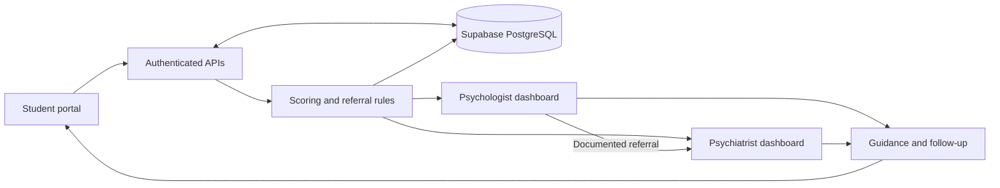

# Architecture and workflow

Flutter web is served by Netlify. Supabase Auth establishes identity; server-controlled mw_staff membership determines professional roles. Public signup grants no professional privileges. Clinical database access uses PostgreSQL RLS; checked SECURITY DEFINER RPCs perform browser writes.

1. Student registers/signs in and creates a consented profile, age 18–25.
2. Questionnaire definitions load from Supabase. Responses save as serialized draft snapshots. Null means unanswered. Completed submissions are immutable and repeat visits create new assessment IDs.
3. PostgreSQL generates each scale total separately. A draft with saved Q9 >0 or another concern creates a safety request; total scores do not need to exist first.
4. Completed routine forms use the service referral rules. Eligible staff are assigned server-side. No eligible staff leaves a pseudonymous queue for a professional to claim.
5. Professionals see assigned/shared cases, review original answers and histories, record private notes and separate student-visible guidance, and schedule appointments.
6. Psychology can refer to an active psychiatrist; both retain membership for coordination. Medical diagnosis/medication fields require the psychiatrist role on the server.
7. Acknowledgement marks responsibility for reviewing a safety request. Resolution requires a documented assessment outcome. An explicit disposition records the subsequent pathway; active requests prevent silent routine downgrades.
8. A trusted worker or pg_cron escalates overdue pending requests to psychiatry. The worker optionally delivers generic notifications through an authenticated webhook. The outbox tracks attempts and delivery; students' clinical content is never sent to the webhook.

## Data ownership

| Data | Student | Assigned/shared professional | Unassigned professional |
| --- | --- | --- | --- |
| Student details | Own | Assigned cases | Hidden |
| Questionnaire responses and scores | Own | Assigned cases | Hidden |
| Private reviews and medical records | Hidden | Assigned cases | Hidden |
| Guidance and appointments | Own | Assigned cases | Hidden |
| Referrals, safety outcomes, audit | Hidden | Assigned cases | Hidden |
| Eligible unassigned queue | Hidden | Pseudonymous code/pathway only | Pseudonymous code/pathway only |
| Role management | Hidden | Hidden | Hidden |

A service administrator provisions staff through trusted tooling, not a fourth application actor. Service-role keys never enter Flutter or Netlify's public bundle.

## Operations

The app is not an emergency service. Professional review, response coverage and emergency procedures are institutional responsibilities. The worker must run on a separate always-on trusted host; Netlify static hosting does not execute it. The demonstration acknowledgement deadline must be replaced by an approved service standard. External messages and appointment reminders are not assumed to exist merely because a database row was saved.

The dashboard refreshes manually. Database revocations apply to new reads immediately; a browser may still show information fetched before revocation until refresh/sign-out. There is no autonomous clinician diagnosis or prescribing engine.
